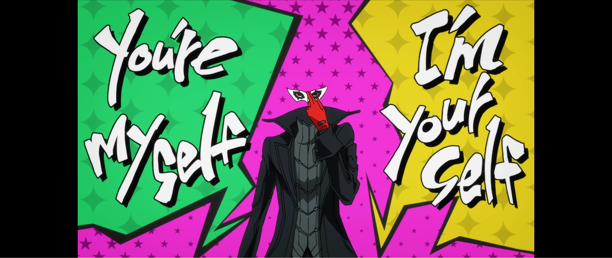
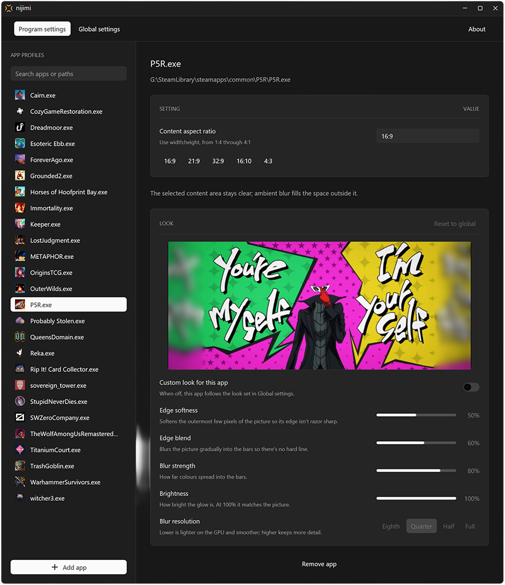

<!--suppress HtmlDeprecatedAttribute -->
<p align="center">
  
</p>

<p align="center">
  <strong>Ambient lighting for the black bars around your games.</strong><br>
  Automatic, lightweight, and out of your way.
</p>

<p align="center">
  <em><strong>nijimi</strong> (滲み): Japanese for the soft bleeding of colour at an edge, like ink spreading into paper.</em>
</p>

---

## What is it?

A small Windows tray app that fills the black bars around a game with a soft, blurred glow taken from the game's own edges. The picture seems to spill out across the whole screen instead of stopping at a hard line.

**Without nijimi:** a 16:9 game on a 21:9 monitor.



**With nijimi:** the bars pick up the colours at the edges of the picture.


## Why use it?

- **Kinder to OLED screens.** Black bars leave their pixels unlit while the rest of the panel ages, so over time the bars can end up brighter than everything else (reverse burn-in). Lighting them with the game's own colours helps the whole screen wear more evenly.
- **Ultrawide, but the game isn't?** Play 16:9 games on a 21:9 or 32:9 monitor, or 4:3 classics on a 16:9 one, without big dead slabs of black either side.
- **Set it once, then forget it.** Give each game an aspect ratio. nijimi turns on when that game is in front and off when you Alt-Tab away.
- **Costs your games next to nothing.** Under 1% of the GPU while you play, and nothing at all when idle ([numbers](#performance)).
- **Never touches the game.** No injection, no hooks, no driver. It's a separate click-through overlay that draws in the bars, not over the game.
- **Portable.** One self-contained `.exe` and an INI file. No installer, no service.

## Getting started

1. Download the latest `nijimi-…-windows-x64.zip` from [Releases](../../releases/latest) and extract it to a folder you can write to.
2. Run `nijimi.exe`. A tray icon appears and **Settings** opens.
3. Choose **Add app…** and pick your game from recent apps, running processes, or **Browse…**.
4. Pick its aspect ratio. Changes save automatically.
5. Launch the game. The glow appears as soon as the game is in front.

Closing Settings leaves nijimi in the tray. Click the tray icon to reopen Settings, or right-click it for **Exit**.

**Requirements:** Windows 10 version 2004 or later, and a Direct3D 11 GPU. No runtimes to install.

## Settings



**Per game:** an aspect ratio (`16:9`, `21:9`, `32:9`, `16:10`, `4:3`, or any `width:height` from `1:4` to `4:1`), plus an optional look that overrides the global one.

**Look** (global, or per game), with a live preview sized to your monitor:

| Setting | What it does |
|---|---|
| Edge softness | Softens the picture's outermost few pixels |
| Edge blend | Blurs the picture gradually into the bars instead of meeting them at a line |
| Blur strength | How far the glow spreads |
| Blur resolution | Full, half, quarter (default), or eighth - lower is cheaper |
| Brightness | 100% matches the picture; 0% gives plain black bars |

**Global:**

| Setting | Default | What it does |
|---|---|---|
| Default aspect ratio | `21:9` | Used for new profiles, and for apps without a profile when Always on is set |
| Frame rate | 30 fps | Update the glow 30 or 60 times a second |
| Always on | Off | Show the effect whatever app is in front |
| Show in screenshots | Off | Let screenshots and recordings capture the glow |
| Hide idle cursor | On | Hide the pointer after it rests in a bar for 2 s (handy with a controller) |
| Start with Windows | Off | Start in the tray when you sign in; if you move the exe, toggle it off and on again |

<details>
<summary>Where settings are stored</summary>

- In `nijimi.ini` beside the executable. Copy both together to move your setup.
- If that folder isn't writable (e.g. `Program Files`), settings go to `%APPDATA%\nijimi\nijimi.ini` instead. A file beside the exe always wins.
- If a hand edit breaks some lines, nijimi backs up the file as `nijimi.ini.bad`, skips those lines and tells you which ones.
- Start with Windows uses `HKCU\Software\Microsoft\Windows\CurrentVersion\Run`, so it needs no admin rights and shows up in Task Manager's **Startup apps**.

</details>

## Limitations

- **Primary display only.**
- **Fixed ratio per game.** nijimi centres the ratio you set on the screen. It doesn't detect the game's actual resolution or window.
- **Some content can't be captured,** such as protected video and some exclusive-fullscreen modes.
- **Older GPUs: latency and VRR.** Modern GPUs keep showing the game directly with nijimi on top, using multiplane overlays (MPO). Tested on an RTX 5090, it added no latency. On GPUs or drivers without MPO, Windows has to compose the game with the overlay instead, which can add up to a frame of latency and affect G-Sync/FreeSync. If that matters for a game, remove its profile.
- **HDR.** The glow is drawn as SDR, at Windows' **SDR content brightness**. HDR highlights are clipped before the blur, which is hard to notice in a soft glow.

## Performance

Release build on a Ryzen 7 9800X3D and an RTX 5090 at 5120×2160, 165 Hz.

**Idle** (no configured game in front):

| | In the tray | After a game session |
|---|---|---|
| CPU | **0 ms** over 60 s | **0 ms** |
| GPU / GPU memory | **0% / 0 MB** | **0% / 0 MB** |
| Memory (private) | **1.6 MB** | **≈4 MB** |

Alt-Tab back within a minute and the overlay returns in about **11 ms**. After that, it takes about **110 ms**, mostly the driver creating a device. Either way the game keeps running normally.

**While playing:** Persona 5 Royal, 60 s, default settings (Quarter, 30 fps), Settings closed.

| nijimi while active | |
|---|---|
| CPU, average | **0.41%** of total CPU |
| CPU, 95th percentile | 1.1% |
| GPU (3D engine) | **0.72%** |
| GPU memory | 293 MB |
| Memory (private) | 17.5 MB |

The game itself averaged 64% of the GPU, peaking at 95%. nijimi's CPU use rises with the game's GPU load, because the driver takes longer to accept each frame when the GPU is busy.

**GPU time per frame** (median of 240 frames, GPU timestamps, 16:9 content):

| Blur resolution | Per frame | Share of GPU at 30 fps | At 60 fps |
|---|---|---|---|
| Eighth | 0.057 ms | 0.17% | 0.34% |
| Quarter (default) | 0.070 ms | 0.21% | 0.42% |
| Half | 0.164 ms | 0.49% | 0.98% |
| Full | 0.205 ms | 0.62% | 1.2% |

Costs scale with resolution and GPU speed. To measure your own system, see [Measuring performance](#measuring-performance).

---

## How it works

nijimi is written in Rust and runs as two processes from the same exe:

- **Tray process (always running).** A small Win32 message loop that owns the tray icon, watches foreground changes with `SetWinEventHook` (no polling), and drives a Direct3D 11 renderer.
- **Settings process (on demand).** `nijimi.exe --settings`, a short-lived [GPUI](https://www.gpui.rs/) window. The UI framework only ever loads here, so the always-running part carries none of it.

**Rendering pipeline**, all in GPU memory:

1. **Capture** the desktop with DXGI Desktop Duplication. The overlay is redrawn only when the screen or settings change.
2. **Sample** the content near the picture's edges, reflected outward and downscaled to the blur resolution.
3. **Blur** with a separable Gaussian and a wider smoothing pass, computed only in and around the bars (pixel-identical to blurring the whole screen). 10-bit and half-float intermediates prevent banding.
4. **Composite** the result outside the game's rectangle, dithered, through a click-through DirectComposition overlay. Edge softness and edge blend fade the picture's outermost pixels into the glow, so there's no visible seam.

**Staying light:**

- **Idle means idle.** With no game in front there's no capture, rendering or timers. GPU resources are kept for one minute (so a quick Alt-Tab is instant), then fully released.
- **Shaders are precompiled** by `build.rs`, so the HLSL compiler never loads at runtime.
- **Pacing** uses a high-resolution waitable timer (`SetTimer` only ticks every 15.6 ms). Ticks with no new desktop frame skip drawing. Faster than about 60 fps, presenting the overlay makes the driver stall, so higher rates aren't offered.
- **Recovery.** Lost capture (a UAC prompt, a mode switch) is retried with backoff up to 4 s, and resources are rebuilt after display changes.

**Idle cursor:** a 1×1 invisible window under the pointer hides it. System cursors are never changed, so a crash can't leave the cursor hidden.

## Development

Install the stable Rust toolchain, then:

```powershell
cargo build --release            # shipped build (full LTO, slow link)
cargo run --profile dev-release  # optimised, thin LTO, for day-to-day testing
cargo test                       # geometry, settings, activation, timing, WARP render tests
```

In RustRover, the shared **Run** configuration uses `dev-release` and **Build** produces the release exe.

### Measuring performance

- **GPU time per frame:** `cargo test --release bench -- --ignored --nocapture --test-threads=1`
- **In a game:** start a release build, launch a game with a profile, then run `powershell -ExecutionPolicy Bypass -File scripts\measure-performance.ps1` and switch to the game during the countdown. It reports CPU, GPU and memory use while the overlay is active, and saves the per-second samples as CSV.

### Releasing

The **Build** workflow tests every push and pull request. To release, bump `version` in `Cargo.toml` and push to `main`. The workflow tags `v<version>` and publishes a zip (exe, README, license) with its SHA-256 checksum.

## Tested on

One setup so far: a single 5120×2160 ultrawide with an NVIDIA GPU on Windows 11. Multiple monitors, other resolutions, rotated displays, AMD/Intel GPUs and HDR may behave differently. If something looks wrong on yours, please [open an issue](../../issues).

## AI disclosure

AI tools were used to help develop nijimi, including writing code and documentation.

## License

[MIT](LICENSE)
