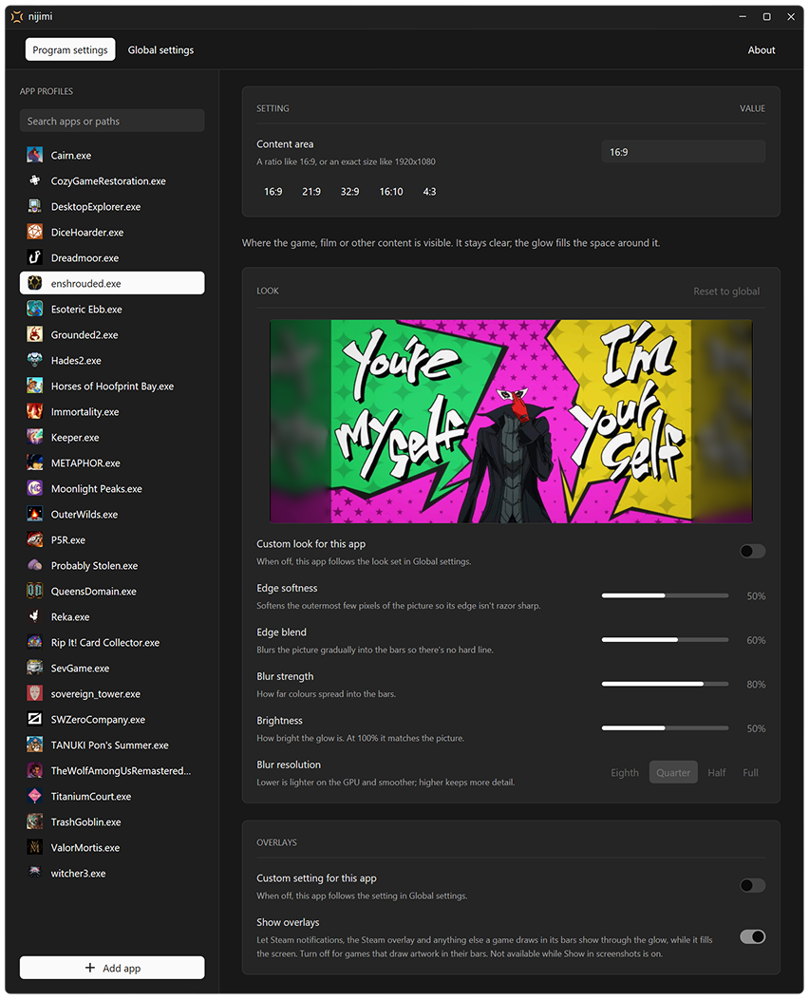

<!--suppress HtmlDeprecatedAttribute -->
<p align="center">
  
</p>

<p align="center">
  <strong>Ambient light for the black bars around your games and videos.</strong><br>
  Automatic, light, and out of your way.
</p>

<p align="center">
  <em><strong>nijimi</strong> (滲み): Japanese for the soft bleed of colour at an edge, like ink that spreads into paper.</em>
</p>

---

nijimi is a small Windows tray app. It fills the black bars around a picture with a soft glow. The glow comes from the colours at the edges of the picture.

**Without nijimi:** a 16:9 game on a 21:9 monitor.


**With nijimi:** the colours at the edges spread into the bars.


## Why use it?

- OLED panels age evenly. Black bars leave pixels unlit while the rest of the panel wears. Over time, the bars can become brighter than the rest of the screen (reverse burn-in). The glow keeps those pixels in use.
- 16:9 games fill a 21:9 or 32:9 monitor, and 4:3 games fill a 16:9 monitor, with no dead black slabs.
- Lower resolutions look better. Run a game below native resolution, in a window or centred without scaling, to keep the frame rate up. The glow fills the bars on all four sides.
- You set it once. Give each app a ratio or a resolution. nijimi starts when that app is in front and stops when you switch away.
- It works with any app: games, video players, emulators.
- The cost is very small. It uses less than 1% of the GPU while active, and nothing when idle ([numbers](#performance)).
- The game stays untouched. nijimi does not inject code, hook the game, or install a driver. It draws a click-through overlay in the bars only.

## Install

1. Download `nijimi-…-setup.exe` from [Releases](../../releases/latest) and run it. It installs for your user only. It does not ask for admin rights.
2. nijimi is not code-signed. Thus, you can see a warning when you download or run the setup:
   - Your browser can show a warning because few people download the file. In Edge, select **…** > **Keep**, then **Show more** > **Keep anyway**. Other browsers have a similar **Keep** option.
   - Windows can show **Windows protected your PC**. Select **More info**, then **Run anyway**.

   These warnings are for the setup only.
3. Keep **Launch nijimi** selected at the end. The tray icon appears and **Settings** opens.
4. Select **Add app**. Pick your game from the recent or running apps, or select **Browse…**.
5. Set its aspect ratio or resolution. nijimi saves changes immediately.
6. Start the game. The glow appears when the game is in front.

Click the tray icon to open Settings. Right-click it for **Exit**. When you close Settings, nijimi stays in the tray.

To update, run the newer setup. It closes nijimi and keeps your settings.

To uninstall, use **Settings > Apps** in Windows. This also removes your settings and the **Start with Windows** entry.

Requirements: Windows 10 version 2004 or later, and a Direct3D 11 GPU.

<details>
<summary>Portable version</summary>

1. Download `nijimi-…-portable-x64.zip`.
2. Move the `nijimi` folder from the zip to a folder you can write to.
3. Run `nijimi.exe`. Windows shows the **Windows protected your PC** prompt once for each new version. Select **More info**, then **Run anyway**.

To update, copy the new `nijimi` folder over the old one. Your settings are in `nijimi.ini`, beside the exe.

To remove nijimi, turn off **Start with Windows**, exit from the tray, and delete the folder.

</details>

## Settings



Each app profile has a content area. This is the part of the screen where the picture shows. It can be:

- An aspect ratio, such as `16:9`, `21:9`, `32:9`, `16:10` or `4:3`. Any ratio from `1:4` to `4:1` is valid. The ratio fills the screen's height or width.
- An exact resolution, such as `1920x1080`. If the app's window is that size, the content area follows the window. If not, it is centred on the screen.

A profile can also have its own look and its own **Show overlays** setting. If not, it uses the global settings.

### Look

Set the look globally or for each app. A live preview shows the result at your monitor's size.

| Setting | Default | What it does |
|---|---|---|
| Edge softness | 50% | Softens the outermost pixels of the picture. |
| Edge blend | 60% | Blurs the picture into the bars, so there is no hard line. |
| Blur strength | 80% | Sets how far the colours spread into the bars. |
| Blur resolution | Quarter | Full, Half, Quarter or Eighth. Lower costs less. |
| Brightness | 100% | 100% matches the picture. 0% gives black bars. |

### Global

| Setting | Default | What it does |
|---|---|---|
| Default content area | `16:9` | New profiles start with this content area. |
| Frame rate | 30 | Updates the glow 30 or 60 times each second. 30 uses half the GPU time. |
| Always on | Off | Shows the glow for all apps. Apps with no profile use the default content area. |
| Show in screenshots | Off | Lets screenshots and recordings capture the glow. When off, they show black bars. |
| Hide idle cursor | On | Hides the cursor when it stays still in the bars for 2 seconds. Useful with a controller. |
| Show overlays | On | Lets notifications in the bars show through the glow. See [Overlays and notifications](#overlays-and-notifications). |
| Start with Windows | Off | Starts nijimi in the tray when you sign in. If you move the exe, turn it off and on again. |

<details>
<summary>Where nijimi keeps its settings</summary>

- nijimi keeps its settings in `nijimi.ini`, beside the exe. The installer puts the exe in `%LOCALAPPDATA%\Programs\nijimi`.
- If nijimi cannot write to that folder (for example, `Program Files`), it uses `%APPDATA%\nijimi\nijimi.ini`. A `nijimi.ini` beside the exe always has priority.
- If nijimi cannot read some lines, it skips them and tells you which lines. It copies the original file to `nijimi.ini.bad` first.
- **Start with Windows** uses `HKCU\Software\Microsoft\Windows\CurrentVersion\Run`. It needs no admin rights. You can see it in Task Manager under **Startup apps**.

</details>

## Overlays and notifications

Some games fill the screen and draw their own black bars. Steam draws its notifications inside the game's picture, so a notification in a corner can fall in a bar, under the glow.

With **Show overlays** on, nijimi removes the glow where the bars are not black. You then see the notification as the game drew it. When the notification goes, the glow comes back. This also works for the Steam overlay, Discord, software cursors and subtitles in a letterbox.

- It applies only when the app in front fills the whole screen. If not, the bars show the desktop, and the glow stays on top.
- It is off when **Show in screenshots** is on. nijimi would then capture its own glow.
- Near-black pixels count as black.
- If a game draws artwork in its bars, the artwork shows through too. Turn off **Show overlays** for that game.

## Limitations

- nijimi works on the primary display only.
- Each app has one fixed content area. nijimi does not look at the picture to find its edges.
- nijimi cannot capture some content, such as protected video and some exclusive fullscreen modes.
- On some GPUs, latency and VRR can change. Modern GPUs use multiplane overlays (MPO) to show the game directly, with nijimi on top. On an RTX 5090, nijimi added no latency. Without MPO, Windows must compose the game with the overlay. This can add up to one frame of latency and can affect G-Sync or FreeSync. If this is a problem for a game, remove its profile.
- The glow is SDR. With HDR on, it uses the Windows **SDR content brightness**. nijimi clips HDR highlights before the blur. In a soft glow, this is difficult to see.

## Performance

Test system: release build, Ryzen 7 9800X3D, RTX 5090, 5120×2160 at 165 Hz.

**While playing** Persona 5 Royal for 60 seconds, with default settings and Settings closed:

| | nijimi |
|---|---|
| CPU, average | 0.41% of total CPU |
| CPU, 95th percentile | 1.1% |
| GPU (3D engine) | 0.72% |
| GPU memory | 293 MB |
| Memory (private) | 17.5 MB |

The game used 64% of the GPU on average. nijimi's CPU use increases with the game's GPU load, because the driver takes longer to accept each frame.

**When idle** (no profiled app in front), nijimi uses no CPU time and no GPU. Its private memory is 1.6 MB after start and about 4 MB after a game session.

If you switch back to the game within one minute, the glow returns in about 11 ms. After one minute, it takes about 110 ms, because the driver must create a new device.

<details>
<summary>GPU time per frame</summary>

Median of 240 frames, measured with GPU timestamps, with 16:9 content.

| Blur resolution | Per frame | GPU share at 30 fps | At 60 fps |
|---|---|---|---|
| Eighth | 0.057 ms | 0.17% | 0.34% |
| Quarter (default) | 0.070 ms | 0.21% | 0.42% |
| Half | 0.164 ms | 0.49% | 0.98% |
| Full | 0.205 ms | 0.62% | 1.2% |

**Show overlays** adds about 0.02 ms for each frame while it applies. In Persona 5 Royal, the GPU share was 0.77% with it on and 0.68% with it off. CPU use did not change.

Costs change with resolution and GPU speed. To measure your system, see [Measuring performance](#measuring-performance).

</details>

## How it works

nijimi is written in Rust. One exe runs as two processes:

- The tray process always runs. It is a small Win32 message loop. It gets foreground changes from `SetWinEventHook`, so it does not poll. It controls a Direct3D 11 renderer.
- The Settings process (`nijimi.exe --settings`) runs only while Settings is open. It uses [GPUI](https://www.gpui.rs/). The tray process does not load the UI framework.

The renderer keeps all data in GPU memory:

1. Capture the desktop with DXGI Desktop Duplication. Draw again only when the screen or the settings change.
2. Sample the picture near its edges. Reflect the samples outward and downscale them to the blur resolution.
3. Blur with a separable Gaussian and a wider smoothing pass. Calculate only the bars and the area near them. The result is identical to a full-screen blur. 10-bit and half-float textures prevent banding.
4. Draw the result outside the content area, with dither, through a click-through DirectComposition overlay. Edge softness and edge blend fade the picture's outer pixels into the glow.
5. For **Show overlays**, mark each 8×8 block of the bars that is not near-black. The overlay is excluded from capture, so the captured bars show only what the game drew. Grow the mask by one block to cover movement. Fade the glow out over the mask.

At **Full** blur resolution, the glow uses half resolution. Only the edge blend uses full resolution. The result looks the same, and full resolution costs about 8 times more.

How nijimi stays light:

- When no profiled app is in front, nijimi does no capture or rendering and runs no timers. It keeps its GPU resources for one minute, then releases them.
- `build.rs` compiles the shaders, so nijimi does not load the HLSL compiler.
- A high-resolution waitable timer sets the frame rate, because `SetTimer` has a 15.6 ms step. If the desktop has no new frame, nijimi does not draw. Above about 60 fps, the driver stalls on each overlay present, so nijimi does not offer higher rates.
- If capture stops (for example, a UAC prompt or a display mode change), nijimi tries again. The wait doubles each time, to a maximum of 4 seconds. After a display change, nijimi rebuilds its resources.

To hide the idle cursor, nijimi puts a 1×1 invisible window under it. nijimi does not change the system cursors. A crash thus cannot leave the cursor hidden.

## Development

Install the stable Rust toolchain. Then:

```powershell
cargo build --release            # shipped build (full LTO, slow link)
cargo run --profile dev-release  # optimised, thin LTO, for daily testing
cargo test                       # geometry, settings, activation, timing, WARP render tests
```

In RustRover, the shared **Run** configuration uses `dev-release`. **Build** makes the release exe.

To make the installer and portable zip in `dist\`:

1. Install [Inno Setup](https://jrsoftware.org/isinfo.php): `winget install JRSoftware.InnoSetup`.
2. Run `powershell -ExecutionPolicy Bypass -File scripts\package.ps1`, or **Package** in RustRover.

### Measuring performance

GPU time per frame:

```powershell
cargo test --release bench -- --ignored --nocapture --test-threads=1
```

In a game:

1. Close Settings. An open Settings window can stop Windows from showing the game directly. This makes nijimi's CPU use about 3 times higher.
2. Start a release build.
3. Start a game that has a profile.
4. Run `powershell -ExecutionPolicy Bypass -File scripts\measure-performance.ps1`.
5. Switch to the game during the countdown.

The script reports CPU, GPU and memory use while the glow is active. It saves the samples for each second as CSV. For a shorter run, add `-Seconds 20`.

### Releasing

The **Build** workflow tests each push and pull request. To make a release, change `version` in `Cargo.toml` and push to `main`. The workflow then creates the `v<version>` tag and publishes the installer and the portable zip.

## Tested on

Only one system: one 5120×2160 ultrawide, an NVIDIA GPU and Windows 11. Results can be different with more than one monitor, other resolutions, rotated displays, AMD or Intel GPUs, and HDR. If something looks wrong, please [open an issue](../../issues). Include the system info from the **About** page in Settings.

## AI disclosure

nijimi was developed with help from AI tools, for code and documentation.

## License

[MIT](LICENSE)
